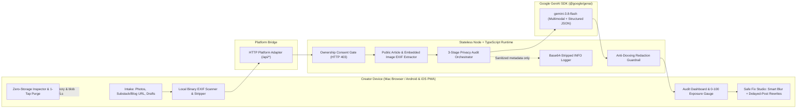

# Unseen

**See what your posts reveal together before someone else connects the dots.**

**Unseen** is an AI-powered cross-platform digital safety and counter-OSINT assistant built for women content creators at the **Ruth & Google AI for Social Good Hackathon** in Los Angeles.

---

## Why Unseen Exists

Most women creators already know not to post their home street sign or driver's license. Real-world stalking and doxxing rarely happen from a single dramatic mistake—they happen **cumulatively across platforms**:

- An **Instagram Story** coffee cup sleeve from a neighborhood café on Tuesday at 8:15 AM
- A **TikTok** walk-and-talk reflection showing a boutique Pilates studio awning two blocks away
- A **Substack essay** mentioning *"living in a quiet duplex three minutes from my morning matcha spot"*—with an embedded original JPEG still carrying **EXIF GPS coordinates**
- A **rooftop sunset photo** whose skyline triangulates the exact residential block

Evaluated alone, every post looks harmless. Evaluated **together**, an obsessive stranger can reconstruct a creator's home radius, weekly schedule, or real-time whereabouts. Grounded in safety guidance from **RAINN**, Unseen gives creators a private, zero-storage pre-flight check before—or after—they hit publish.

---

## Core Capabilities

### 1. Multi-Source Creator Content Intake (`Intake`)
- **Camera Roll Photo Upload:** Batch-audit original `JPEG`, `PNG`, `WebP`, and `HEIC` photos (`<= 20 MB` per file) directly from Mac or mobile Camera Roll.
- **Public Blog & Substack URL Importer:** Fetches public essay text (`<article>`, `<main>`, OpenGraph metadata) **and** inspects embedded `` photos inside the article for hidden EXIF metadata leaks.
- **Draft Caption & Story Notes:** Paste upcoming captions, YouTube descriptions, or newsletter drafts before publishing.
- **1-Tap Creator Demo Feed:** Instant 6-post cross-platform dataset (*Maya Lin — LA lifestyle creator across Instagram, TikTok, and Substack*) for live interactive judging.

### 2. Binary EXIF GPS, Capture-Time & Device Metadata Scanner + Lossless Stripper
- Inspects raw binary `APP1` TIFF/IFD (`IFD0`, `ExifIFD`, `GPSInfoIFD`), PNG `eXIf`/`iTXt`/`tEXt`, WebP `EXIF`/`XMP `, and HEIC `Exif` segments **before** stripping.
- Detects hidden **GPS coordinates**, **original capture weekday/time windows**, and **camera/lens serial tags** without ever echoing raw coordinates into logs, prompts, or UI.
- **Automatic Local Scrubbing:** Immediately strips EXIF/XMP/IPTC metadata in browser memory on upload and losslessly scrubs binary metadata on every Safe Export.

### 3. 3-Stage Multimodal Google Gemini (`gemini-3.8-flash`) Pipeline (`Audit`)
Powered by the official `@google/genai` SDK (`vertexai: false` with structured JSON schemas):
1. **Stage 1 — Multimodal Clues & Small-PII Bounding Boxes:** Scans images, prose, and detected EXIF signals together. Extracts location, routine, visual PII, and proximity clues plus normalized `[0..1000]` bounding boxes strictly around **small redactable PII** (shipping labels, mail envelopes, badges, license plates, unit/apartment numbers, laptop screens).
2. **Stage 2 — Cross-Platform Pattern Connector & `0–100` Exposure Index:** Correlates clues across posts to surface explainable `"With X% confidence..."` insights that cite **specific repeated venues, visual cues, and post titles** while strictly redacting private street addresses, apartment numbers, and raw GPS coordinates. Computes a deterministic `0–100` **Cumulative Exposure Index** (`Low` / `Moderate` / `High` / `Critical`).
3. **Stage 3 — Context-Aware Safe Fix Studio (`Make Post Safer`):**
   - **Small Redactable PII (e.g., apartment numbers, shipping labels, badges):** Renders automatic HTML5 Canvas Gaussian Smart Blur regions with human-in-the-loop toggle pills and **drag-to-draw custom blur boxes** on desktop and touch screens.
   - **Major Landmarks (e.g., Eiffel Tower, Hollywood Sign, city skylines):** Skips pointless full-photo blurring and instead surfaces **Delayed-Posting Guidance** (*wait 24–72 hours after leaving the area*) alongside **past-tense, time-shifted caption rewrites** that preserve creator voice.

### 4. Personalized Safety Playbook (`Checklist`), Defensive Photo Noise (`Photo Noise`) & Live Zero-Storage Proof (`Zero Storage`)
- **Personalized Safety Playbook:** Combines triggered scan-specific action items with RAINN-aligned creator safety habits and exports as a local `.md` file.
- **Photo Noise Studio:** Client-side defensive perturbation preview (`Subtle` and `Cloak` modes with adjustable `5%–100%` strength) for protecting creator portraits before sharing.
- **Verifiable Zero-Storage Architecture:** Live in-app browser storage inspector proving `0` `localStorage` keys, `0` `sessionStorage` keys, `0` cookies, and `0` database persistence—paired with a 1-tap **`Purge` Panic Wipe** that clears React state and revokes blob URLs immediately.
- **Mac Studio + Installable Android / iOS PWA:** Runs seamlessly in desktop browsers (with a live `Studio / Mobile` `390×844` viewport preview) and installs to Android Chrome / iOS Safari home screens via Web App Manifest + offline-safe Service Worker.

---

## System Architecture



Detailed module boundaries, data contracts, and observability conventions are documented in [`Design.md`](./Design.md).

---

## Quickstart & Local Setup

### Prerequisites
- **Node.js `>= 20`** and `npm`
- A **Google AI Studio API Key** (`GEMINI_API_KEY`) for live `gemini-3.8-flash` inference *(if omitted, Unseen automatically runs in deterministic offline demo-fallback mode so tests and UI previews always work out of the box)*

### 1. Install Dependencies
```bash
npm install
```

### 2. Configure Environment
Copy `.env.example` to `.env` and add your Gemini API key:
```bash
cp .env.example .env
```
```dotenv
GEMINI_API_KEY=your_gemini_api_key_here
UNSEEN_GEMINI_MODEL=gemini-3.8-flash
UNSEEN_LOG_LEVEL=INFO
UNSEEN_ENABLE_DEMO_FALLBACK=true
```

### 3. Build & Start the Unified Server (Recommended)
Builds the TypeScript + Vite production bundle into `dist/` and starts the unified API + static PWA server on **`http://localhost:3001`**:
```bash
npm run build
npm start
```
Open **`http://localhost:3001`** in Chrome or Safari. Look for the **`Gemini Live`** badge in the top bar to confirm live `gemini-3.8-flash` connectivity.

*(For hot-reload frontend + backend development, run `npm run dev` to launch Vite on `http://localhost:5173` proxying `/api` to `http://localhost:3001`.)*

### Installing on Android or iOS (PWA)
1. Expose port `3001` on the same Wi-Fi network or via an HTTPS tunnel (or `adb reverse tcp:3001 tcp:3001` over USB on Android).
2. Open the URL in **Android Chrome** and tap **Install App / Add to Home Screen** (or **Share -> Add to Home Screen** in iOS Safari).

---

## Automated Testing (`npm test`)

Unseen includes **33 automated unit and integration tests across 6 Vitest suites** verifying guardrails, binary EXIF parsing/stripping, Gemini pipeline fallbacks, landmark non-blur filtering, API routes, and zero-storage sanitization:

```bash
npm test
```

| Test Suite | Coverage Highlights |
| :--- | :--- |
| `tests/foundation.test.ts` | Centralized config defaults (`gemini-3.8-flash`), recursive base64 payload sanitizer, `INFO` structured logger |
| `tests/guardrailsAndDataset.test.ts` | Self-audit ownership attestation (`403` without consent), street address / unit / GPS anti-doxxing scrubber, 6-post Maya Lin dataset |
| `tests/exifScannerAndStripper.test.ts` | Binary JPEG `APP1` TIFF/GPS & PNG `eXIf`/`iTXt` detection without coordinate leakage, plus lossless binary EXIF stripping |
| `tests/geminiPipelineAndArticle.test.ts` | Deterministic `0–100` scoring engine, Substack/blog HTML + embedded photo EXIF extraction, 3-stage orchestrator, Eiffel Tower landmark no-blur filter |
| `tests/serverAndPlatform.test.ts` | Live HTTP server routes (`/api/health`, `/api/demo-feed`, `/api/extract-article`, `/api/scan-exif`, `/api/audit`, `/api/fix-post`, `/api/feedback`) |
| `tests/uiHelpersAndExport.test.ts` | Personalized `.md` checklist exporter, bounding-box coordinate clamping, canvas smart-blur state helpers |

---

## Responsible AI & Safety by Design

1. **Self-Audit Ownership Consent Gate:** Every UI scan and `/api/audit` request requires explicit attestation that the creator owns or has permission to audit the content (`HTTP 403` enforced server-side if absent) so Unseen cannot be misused as a stalking reconnaissance tool.
2. **Anti-Doxxing Output Scrubbing:** Both system prompts and `antiDoxxingGuardrail.ts` allow citing general neighborhoods and repeated public venues so warnings are actionable, while deterministically redacting exact residential street addresses, apartment/unit numbers, and raw GPS coordinates.
3. **Human-in-the-Loop Oversight & Honest Limitations:** Every audit displays a plain-language AI limitations banner (*Unseen lowers unintentional oversharing risk; it cannot guarantee 100% safety*), lets creators flag `Accurate` or `Missed Something` anonymously, and gives creators manual control over every blur box and caption edit before export.
4. **Zero Persistent Storage & Sanitized Logs:** Uploaded photos, drafts, and scan outputs exist strictly in ephemeral memory. Server `INFO` observability logs automatically strip base64 image payloads via `payloadSanitizer.ts`.

---

## Project Structure

```text
├── Design.md                         # Living architecture & privacy guardrail reference
├── public/                           # PWA manifest, service worker, icons & demo media
├── src/
│   ├── config/appConfig.ts           # Centralized env-backed settings & thresholds
│   ├── domain/privacyTypes.ts        # Shared TypeScript contracts across client & server
│   ├── features/
│   │   ├── article-import/           # Public blog/Substack HTML + image EXIF extractor
│   │   ├── audit-pipeline/           # End-to-end Stage 1-3 privacy audit orchestrator
│   │   ├── best-practices/           # Personalized safety playbook & .md exporter
│   │   ├── caption-rewriter/         # Stage 3 caption rewrites & delayed-posting plans
│   │   ├── demo-dataset/             # 6-post Maya Lin cross-platform creator feed
│   │   ├── exif-scanner/             # Binary TIFF/IFD parser, EXIF scanner & lossless stripper
│   │   ├── feedback/                 # Anonymous accuracy/missed-risk counter store
│   │   ├── guardrails/               # Ownership attestation & anti-doxxing scrubber
│   │   ├── image-redactor/           # HTML5 Canvas Gaussian Smart Blur + EXIF scrub
│   │   ├── post-scan/                # Stage 1 multimodal visual + text + EXIF scanner
│   │   ├── risk-connector/           # Stage 2 cross-post connector & 0-100 scoring engine
│   │   └── upload/                   # Camera Roll validation, local EXIF scan & strip
│   ├── genai/geminiClient.ts         # Official @google/genai SDK wrapper (vertexai: false)
│   ├── logging/                      # Base64 payload sanitizer & structured INFO logger
│   ├── platform/                     # Cross-platform UI-to-backend bridge
│   ├── server/                       # Stateless Node HTTP router & static PWA server
│   └── ui/                           # Editorial React Studio + Mobile PWA interface
└── tests/                            # 6 Vitest unit & integration test suites (33 tests)
```
