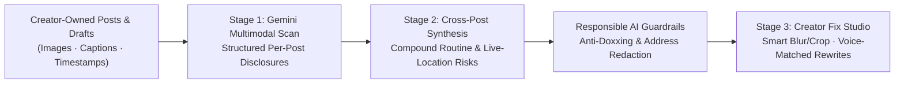

# Unseen

**Your AI Digital Safety Assistant for Creators**

> *"Unseen helps women creators see what their online presence unintentionally reveals about them, before that information can be used to compromise their privacy or safety."*

Built at the **Ruth & Google AI for Social Good Hackathon (Los Angeles)**.

---

## The Problem

Women content creators build their careers by sharing pieces of their lives online—across Instagram Stories, YouTube vlogs, Substack essays, and more.

Individually, each post often looks completely harmless:
- An **Instagram Story** shows a morning coffee cup by a familiar neighborhood window.
- A **YouTube vlog** catches two seconds of the street outside a fitness studio.
- A **Substack newsletter** mentions writing at a favorite corner café every Tuesday morning.
- A **workspace photo** includes a shipping label or piece of mail in the corner.
- A **draft caption** reveals the creator is still at an event in real time.

Existing tools check account privacy settings, strip EXIF metadata, or scan a single image in isolation. **Unseen evaluates cumulative exposure across a creator's own cross-platform content**, grounded in digital safety guidance from organizations like [RAINN](https://www.rainn.org/) on limiting real-time location sharing and predictable routine disclosures.

---

## Product Experience

### 1. Scan Your Online Presence
Creators upload or select their own content across **Instagram, YouTube, Substack**, and unpublished drafts. Gemini's multimodal understanding analyzes images, video frames, captions, and timestamps for subtle visual and contextual disclosures.

### 2. Connect Cumulative Risks Across Platforms
Rather than flagging an isolated landmark, Unseen links disclosures across multiple posts to surface **compound privacy patterns**—such as predictable weekly routines, real-time whereabouts, or recurring background identifiers—with clear visual evidence showing which posts contributed.

### 3. Fix It Before Posting
Creators open any flagged post or draft in a pre-publication studio to:
- **Redact sensitive visuals** (blur or crop documents, mail, badges, or reflections).
- **Rewrite captions in their own voice** (removing real-time or schedule cues without losing personality).
- **Adjust publish timing** (delaying live travel or event posts until after leaving the location).
- **Preview Before vs. After** so they can share confidently without sacrificing authenticity.

---

## What Makes Unseen Different

| Existing Privacy Tools | Unseen |
| :--- | :--- |
| Checks account privacy toggles | Reviews what the content itself discloses |
| Strips photo EXIF metadata | Analyzes visuals, backgrounds, captions, and timing together |
| Audits one post in isolation | Connects cumulative patterns across platforms |
| Issues generic security warnings | Recommends concrete, voice-preserving edits before publishing |
| Built with cybersecurity jargon | Designed as an approachable, visual creator studio |

---

## Architecture & Google AI (`Gemini`)

- **Multimodal Extraction:** Uses Google Gemini vision + text reasoning to identify sensitive objects, readable documents, and temporal cues with structured outputs.
- **Cross-Platform Reasoning:** Synthesizes per-post findings across platforms to detect multi-post exposure patterns.
- **Voice-Preserving Generation:** Suggests natural caption alternatives tailored to a creator's tone rather than generic warnings.

---

## Responsible Design Principles

1. **Strictly Self-Auditing:** Designed exclusively for creators reviewing content they own or are authorized to manage—never for surveilling third parties.
2. **Anti-Doxxing Guardrails:** Unseen explains *categories* of exposure and highlights contributing posts, while strictly refusing to infer or output exact home addresses, coordinates, or movement maps.
3. **Honest Limitations & Human Oversight:** Rather than promising a misleading "100% Privacy Score," Unseen tracks *addressed exposures*, communicates AI limitations clearly, and keeps creators in full control of every edit.
4. **Ephemeral by Default:** Content uploaded for auditing is processed ephemerally without persistent cloud tracking of personal media.
